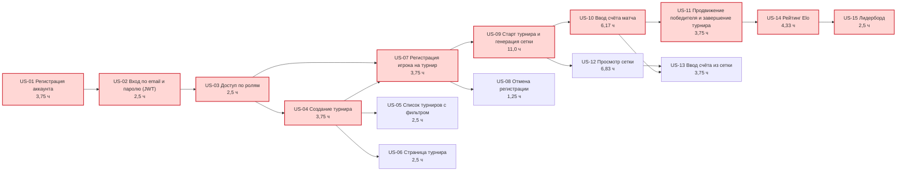

# План релиза

## Цель

Построить сетевой график MVP, найти критический путь и оценить вероятность завершения MVP к защите ЛР 3 — по PERT и методом Монте-Карло.

## Исходные данные

- Состав MVP — US-01…US-15 из [prioritization.md](prioritization.md), зависимости — [data/backlog.csv](data/backlog.csv).
- Длительность — [data/tasks.csv](data/tasks.csv) в формате `pert_cpm.py`: для пяти историй из [estimates.md](estimates.md) — трёхточечные оценки, для остальных o = m = p = SP × 1,25 ч (σ = 0).
- Срок: 7 недель, с 19.10.2026 по 04.12.2026. Один участник даёт 10 × 0,6 = 6 сфокусированных часов в неделю, значит цепочка последовательной работы должна уложиться в 7 × 6 = **42 ч**.
- Пропускная способность для Монте-Карло — условная история 1, 2, 3, 4 истории в неделю.

## Сетевой график

Красным выделен критический путь; в узле — история и её ожидаемая длительность.



## Расчёт CPM

```bash
cd scripts
python pert_cpm.py ../docs/01-planning/data/tasks.csv --deadline 42 --mermaid
```

Полный вывод — [output/pert-cpm.txt](output/pert-cpm.txt).

ES/EF — раннее начало и окончание, LS/LF — позднее, R — полный резерв. Всё в часах.

| ID    | Длительность | ES    | EF    | LS    | LF    | R     |
| ----- | ------------ | ----- | ----- | ----- | ----- | ----- |
| US-01 | 3,75         | 0     | 3,75  | 0     | 3,75  | 0     |
| US-02 | 2,50         | 3,75  | 6,25  | 3,75  | 6,25  | 0     |
| US-03 | 2,50         | 6,25  | 8,75  | 6,25  | 8,75  | 0     |
| US-04 | 3,75         | 8,75  | 12,50 | 8,75  | 12,50 | 0     |
| US-05 | 2,50         | 12,50 | 15,00 | 41,50 | 44,00 | 29,00 |
| US-06 | 2,50         | 12,50 | 15,00 | 41,50 | 44,00 | 29,00 |
| US-07 | 3,75         | 12,50 | 16,25 | 12,50 | 16,25 | 0     |
| US-08 | 1,25         | 16,25 | 17,50 | 42,75 | 44,00 | 26,50 |
| US-09 | 11,00        | 16,25 | 27,25 | 16,25 | 27,25 | 0     |
| US-10 | 6,17         | 27,25 | 33,42 | 27,25 | 33,42 | 0     |
| US-11 | 3,75         | 33,42 | 37,17 | 33,42 | 37,17 | 0     |
| US-12 | 6,83         | 27,25 | 34,08 | 33,42 | 40,25 | 6,17  |
| US-13 | 3,75         | 34,08 | 37,83 | 40,25 | 44,00 | 6,17  |
| US-14 | 4,33         | 37,17 | 41,50 | 37,17 | 41,50 | 0     |
| US-15 | 2,50         | 41,50 | 44,00 | 41,50 | 44,00 | 0     |

**Критический путь**: US-01 → US-02 → US-03 → US-04 → US-07 → US-09 → US-10 → US-11 → US-14 → US-15, длина T = 44,0 ч.

Технические задачи T-01…T-08 в график не включены: их ведёт второй участник параллельно с историями, и у них большой резерв. Исключение — T-01…T-03 должны быть готовы до первого PR с US-01, иначе он не пройдёт CI.

## Вероятность по PERT

σ пути складывается только из историй с трёхточечной оценкой на критическом пути: US-09, US-10, US-14.

σ = √(2,33² + 1,17² + 1,00²) ≈ 2,79 ч

Z = (42 − 44,0) / 2,79 ≈ −0,72, **P(T ≤ 42 ч) ≈ 24 %**.

| Ситуация                                                                                             | T, ч | P    |
| ---------------------------------------------------------------------------------------------------- | ---- | ---- |
| План как есть                                                                                        | 44,0 | 24 % |
| Задержка истории на критическом пути на 3 дня (≈ 2,6 сфокусированных ч)                              | 46,6 | 5 %  |
| Доменная часть US-09 (`generateBracket`, ≈ 6 ч) делается вторым участником параллельно с US-01…US-07 | 38,0 | 92 % |

Задержка любой истории с нулевым резервом на 3 дня сдвигает весь MVP на те же 3 дня. Задержка US-05, US-06, US-08 до 26 ч или US-12, US-13 до 6 ч на срок не влияет.

## Прогноз Монте-Карло

10 000 прогонов, seed = 42: каждую неделю закрывается число историй, случайно выбранное из истории 1, 2, 3, 4; считается, за сколько недель закроются 15 историй MVP.

```bash
cd scripts
python monte_carlo.py --history 1 2 3 4 --backlog 15
```

Полный вывод — [output/monte-carlo.txt](output/monte-carlo.txt).

| Недель | Доля прогонов | Накопленная |
| ------ | ------------- | ----------- |
| 4      | 2,0 %         | 2,0 %       |
| 5      | 19,6 %        | 21,6 %      |
| 6      | 35,7 %        | 57,3 %      |
| 7      | 26,7 %        | 84,0 %      |
| 8      | 12,1 %        | 96,2 %      |
| 9      | 3,1 %         | 99,3 %      |
| ≥ 10   | 0,7 %         | 100 %       |

- **50 %**: 6 недель — до 29.11.2026.
- **85 %**: 8 недель — до 13.12.2026, то есть после защиты ЛР 3.
- Вероятность уложиться в 7 недель — **84 %**.

В ЛР 4 прогноз пересчитывается на реальной пропускной способности из Jira.

## Сравнение прогнозов

PERT даёт 24 %, Монте-Карло — 84 %. Монте-Карло по пропускной способности считает истории независимыми: две истории в неделю могут идти параллельно. PERT по критическому пути учитывает, что US-09 нельзя начать до US-07, а US-14 — до US-11, поэтому почти вся работа выстраивается в одну цепочку. Реальность ближе к PERT, пока зависимости не разорваны.

## Выводы

- Узкое место — последовательная цепочка через US-09. При текущем плане срок под риском.
- Решение — разорвать зависимость: `generateBracket`, `validateScore` и `eloUpdate` — чистые функции без API, их можно разрабатывать вторым участником с первой недели. Это поднимает вероятность до ≈ 92 %.
- Точечная оценка «44 ч» скрыла бы, что шанс уложиться — один из четырёх; вероятностный прогноз показывает, где и насколько менять план.
